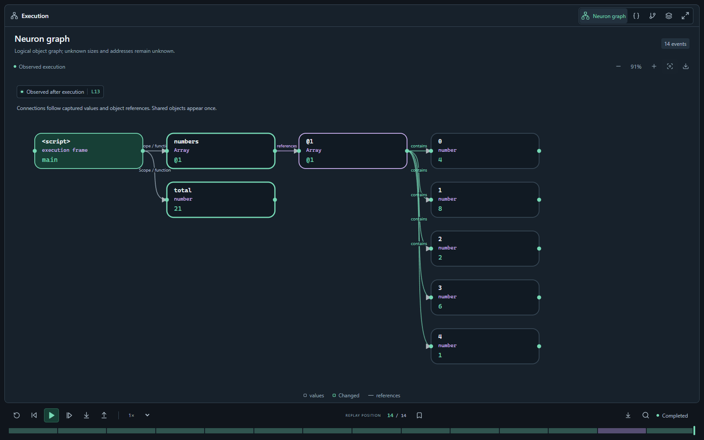

# TraceScope

[Open the WebUI](https://ilcde.github.io/tracescope/) · [Download packages](https://github.com/ilcde/tracescope/releases) · [Install](docs/INSTALL.md) · [English guide](docs/USER-GUIDE.en.md) · [Tiếng Việt](docs/USER-GUIDE.vi.md)

[](https://github.com/ilcde/tracescope/actions/workflows/verify.yml)
[](https://github.com/ilcde/tracescope/actions/workflows/pages.yml)

TraceScope captures real program execution and displays typed values, object references, source paths, call stacks and available machine/VM instructions. Replay reads the captured log without repeating program side effects. The interface supports English and Vietnamese.



## What works

- Python, Java, Kotlin, C, C++, Rust, JavaScript and TypeScript run through actual interpreters, compilers, debuggers or a WebAssembly VM. HTML/CSS use actual WASM parsing and browser rendering.
- Multi-file projects: Python imports, Rust modules, C/C++ translation units and headers, JVM source sets, JS/TS relative ES modules, HTML with local CSS. Syntax highlighting covers every listed language.
- Typed neuron graph, shared object identities, bounded object/aggregate fields, zoom, fit, SVG export, resizable panels and a dedicated fullscreen diagram with replay controls.
- Python live stepping, conditional breakpoints and value-change watches; all adapters support captured-history navigation at their documented observation granularity.
- Eight real assembly teaching profiles: x86-16/32/64, ARM, Thumb, AArch64, RV32 and RV64. Registers and memory effects come from Unicorn execution.
- Project save/import and local persistence, immutable source snapshots, trace export/import, separate benchmark execution and a conservative complexity analyzer.

## Platforms

| Platform | Distribution and verification |
|---|---|
| Web | Public GitHub Pages; Chromium interaction tests, desktop and phone layouts |
| Windows x86-64 | Portable ZIP with CPython; actual compiler/debugger tests on `windows-2025` |
| Fedora 43 / 44 x86-64 | Distribution-specific RPM and offline bundle; backend, installation and GTK/Xvfb jobs |
| Ubuntu 24.04 x86-64 | DEB and offline bundle; backend, installation and GTK/Xvfb jobs |
| Android 8+ | Offline WebView debug APK; CI build and Android 16 emulator checks |

Inspect the latest linked workflow for the exact commit's results. Container X11 checks do not establish physical Wayland, SELinux-enforcing desktop or all-distribution compatibility. Android physical-device acceptance remains open.

GitHub Pages runs JavaScript/TypeScript locally in QuickJS WASM and renders HTML/CSS locally. Python, JVM, native languages and assembly need your installed runner. Pages cannot execute native processes for visitors. Connect an HTTPS runner in Run settings, or use the runner's local WebUI.

## Start from source

Windows:

```powershell
powershell -ExecutionPolicy Bypass -File scripts/setup.ps1
powershell -ExecutionPolicy Bypass -File scripts/setup-toolchains.ps1
.venv\Scripts\python.exe -m tracescope desktop --trusted-local
```

Linux, after installing the distribution dependencies in the [installation guide](docs/INSTALL.md):

```bash
bash scripts/setup-linux.sh
.venv/bin/python -m tracescope desktop --trusted-local
```

Use `serve` instead of `desktop` for a browser window. Omit `--trusted-local` to keep native execution locked. That flag gives programs normal host access; it is **not a sandbox**. Native language compilers, JDK and Kotlin are separate prerequisites. `python -m tracescope doctor` reports discovery results.

## Verification and building

```bash
npm ci
npm test
npm run build
npx playwright install --with-deps chromium
node tests/web-ui.mjs
python -m pytest tests/test_core.py tests/test_journeys.py tests/test_connection.py tests/test_projects.py tests/test_aggregates.py tests/test_conditions.py -q -p no:faulthandler
```

Build Windows with `scripts/build_windows.ps1`, Android with `python scripts/build_android.py`, Fedora with `python scripts/build_linux.py --rpm`, or Ubuntu with `python scripts/build_linux.py --deb`. Build Linux packages on the target distribution; their wheels match its Python ABI. CI uploads test evidence and Linux/Android packages. Local sessions, caches and credentials are excluded from publication.

## Completion status

**Version 0.2 is a development preview. The entire original product brief is not complete, and no error-free or universal-language claim is made.** All ten requested languages have real, tested paths within the [documented baselines](docs/BASELINES.md). Open requirements include native isolation, Cargo/CMake/Maven/Gradle orchestration, a DOM/event bridge, complete ownership/lifetime/dependency reconstruction, live controls for every backend, JIT/WASM instruction-state inspection and broader complexity proofs.

See the [full requirement ledger](docs/REQUIREMENTS.md), [machine-readable capabilities](capabilities.json), [security boundary](docs/SECURITY.md), [project format](docs/PROJECTS.md) and [delivery record](docs/DELIVERY.md). The [original brief](docs/PRODUCT-BRIEF.md) remains intact.
